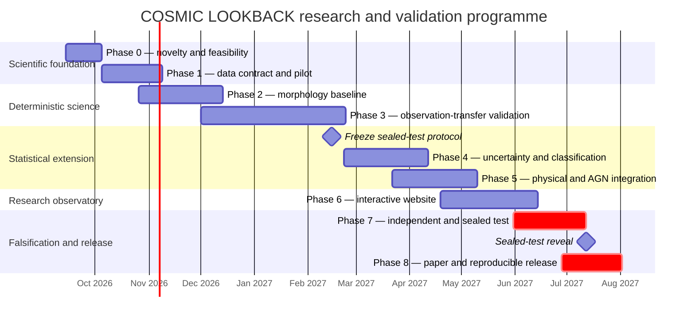

# COSMIC LOOKBACK: scientific design, novelty audit and implementation-ready research specification

**Author:** Biswajit Jana  
**Repository edition:** 14 September 2026

## Executive summary and scientific decision

The otherwise unspecified research topic is made explicit by the attached project specification: **COSMIC LOOKBACK**, an uncertainty-aware, reproducible pipeline and interactive research observatory for studying high-redshift galaxy morphology, physical properties and AGN activity across cosmic time. The specification asks, in particular, whether galaxy morphology would receive the same scientific interpretation if the same object were observed at another redshift, wavelength, depth or telescope resolution.  This report therefore treats that astronomy project—not unrelated technology, health, environment or economics topics—as the operative research topic.

**Recommendation: proceed, but do not build “another JWST morphology classifier”.** The strongest scientifically defensible project is an **observational degradation-aware morphology laboratory**, with the primary outcome being a *recoverability or stability function* for morphological conclusions under controlled changes in observing conditions. Existing work already covers almost every constituent technique: artificial redshifting, quantitative morphology, multi-band Sérsic fitting, JWST visual and machine-learning classification, cross-survey domain adaptation, citizen-science morphology and large catalogues of JWST structural parameters. FERENGI established realistic artificial redshifting including angular-size changes, surface-brightness dimming, spectral changes, PSF convolution, resampling and noise; GALFITM demonstrated wavelength-dependent, multi-band profile fitting and explicitly tested redshift-induced biases; Yu et al. quantified CEERS morphology biases with artificially redshifted DESI galaxies; CEERS has published visual and quantitative JWST morphologies to \(z\sim9\); and DeepAstroUDA already addresses cross-survey morphology domain adaptation. 

The novelty claim should consequently be narrow:

> **COSMIC LOOKBACK would not claim novelty for artificial redshifting, galaxy classification, Sérsic fitting, uncertainty estimation or multi-band morphology individually. Its defensible contribution would be a reproducible observation-transfer benchmark in which the scientific quantity of interest is whether a morphological conclusion survives controlled changes in redshift, rest-frame wavelength, PSF, pixel sampling, depth and noise—with per-object provenance, calibrated abstention and explicit separation of observed, measured, inferred, simulated and unavailable quantities.**

Our audit did **not identify an existing public project that makes that complete observation-transfer stability question the central per-object scientific product**, while simultaneously exposing counterfactual images, measurement changes, uncertainty decomposition, abstention/OOD state and cross-survey validation in an interactive research atlas. That is an absence-of-evidence result from the audit, **not proof of uniqueness**. Strong precedents exist for essentially every component. 

### Recommended scientific question

The broad question in the specification should be sharpened to:

> **Over what region of image quality, intrinsic size, surface brightness, redshift and rest-frame wavelength are commonly used galaxy-morphology measurements and interpretations observationally recoverable, and how much apparent morphological evolution remains after galaxies are compared under matched observing conditions?**

That immediately produces falsifiable hypotheses:

| Hypothesis | Testable prediction | What falsifies it |
|---|---|---|
| **H1 — information quality dominates redshift itself** | Recoverability is more tightly predicted by quantities such as \(R_{\rm e}/{\rm FWHM}\), surface-brightness S/N and segmentation stability than by redshift alone. Yu et al. already found strong resolution dependence, including an asymmetry reliability boundary around \(R_{\rm p}/{\rm FWHM}\ge5\) in their setup.  | Residual redshift dependence remains large after conditioning on those observational variables. |
| **H2 — some apparent morphological evolution is observational** | Matching PSF, depth, sampling and rest-frame wavelength reduces at least part of the measured evolution in asymmetry, clumpiness or disturbance. Artificial-redshifting literature establishes that these quantities can change systematically with observing conditions.  | Matched-observation comparisons recover essentially unchanged evolutionary trends. |
| **H3 — different metrics have different recoverability surfaces** | Size, axis ratio and low-order parametric measures retain useful information deeper into the low-resolution regime than asymmetry/clumpiness or subtle merger signatures. Existing artificial-redshifting experiments already suggest such differential robustness.  | All metrics fail or remain reliable at approximately the same observational boundary. |
| **H4 — abstention is scientifically superior to forced classification** | A calibrated “uncertain/insufficient information/OOD” mechanism lowers error and domain-shift bias among retained classifications, with an explicit accuracy–coverage trade-off. Cross-survey work demonstrates that dataset shift is material in galaxy classifiers.  | Abstention does not improve conditional reliability or simply rejects scientifically interesting populations systematically. |
| **H5 — physics-aware observation matching beats classifier complexity** | Explicit PSF/depth/rest-wavelength harmonisation plus a modest classifier transfers at least as reliably as a substantially more complex network trained without such controls. | A complex domain-adapted model is demonstrably better calibrated and more transferable after fair validation. |

### Scope decision

A nominal \(1<z<10\) catalogue can be supported, but **the first quantitative morphology release should concentrate on approximately \(1.5\lesssim z\lesssim6\)**. CEERS already demonstrates morphology work at \(z=3\)–9, but also explicitly warns that high-redshift morphological fractions are affected by selection effects; at the highest redshifts galaxies become increasingly marginally resolved and surface-brightness features disappear.  NIRCam covers roughly 0.6–5 μm, making multiple rest-frame UV/optical comparisons possible over much of the proposed core interval; its native SW/LW pixel scales are about 0.031/0.063 arcsec and the PSF broadens strongly with wavelength, so resolution is itself a first-order variable that cannot be ignored. 

Objects at \(6<z<10\) should therefore enter the first release as a **frontier/OOD stratum** with deliberately weaker claims: compactness, elongation, multiplicity and coarse structural information may be publishable when resolution/S/N gates are passed, while detailed “disk versus irregular versus merger” interpretations should not automatically inherit the calibration established at lower redshift. Published JWST studies already reach \(z\sim8\)–9 and beyond, but that demonstrates availability of targets rather than uniform recoverability of detailed morphology. 

A practical comparison of possible project directions is:

| Candidate project direction | Scientific scope | Estimated research + prototype effort* | Required expertise | Novelty risk | Priority |
|---|---:|---:|---|---|---:|
| **Observation-transfer morphology laboratory** | Recoverability surfaces, artificial redshifting, cross-survey stability, abstention, interactive counterfactual comparison | **75–110 person-days** | Galaxy morphology, image simulation, statistics, astronomy software, frontend | **Lowest** provided the benchmark is central | **1** |
| Multimodal morphology + SED + AGN atlas | Morphology linked to masses/SFR/SEDs and multi-indicator AGN evidence | 100–150 person-days | Above plus SED fitting, catalogue cross-matching, AGN science | Moderate; catalogues already provide many ingredients | 2 |
| Deterministic JWST morphology catalogue | Sérsic + non-parametric measurements across public surveys | 40–60 person-days | Image analysis, survey calibration | High; many comparable catalogues now exist | 3 |
| New supervised JWST image classifier | Multi-class CNN/ViT labels | 50–80 person-days | ML, label curation | **Very high**; scientifically weak unless it answers a new transfer/calibration question | 4 |

\*These are planning estimates for one technically experienced researcher and are **not empirical facts**; website polishing and publication cycles can extend elapsed time substantially.

The smallest publishable scientific result is consequently **not** the website and **not** a neural network. It is a benchmark paper/data release giving, for a pre-registered set of morphology measurements, the empirical *recoverability boundary* as a function of resolution, S/N, surface brightness, wavelength and redshift, validated through synthetic injection, artificial redshifting and at least one genuinely held-out survey.

## Novelty audit and defensible contribution

The novelty audit was conducted against the literatures and ecosystems named in the project specification: refereed literature/arXiv and NASA ADS-indexed work, public astronomy software and GitHub repositories, Zenodo, Hugging Face, Kaggle and Galaxy Zoo/citizen science. The result is unequivocal: **the ingredients are mature; the research framing is where novelty must live.**

### Closest scientific precedents

| Existing work/project | What already exists | Overlap with COSMIC LOOKBACK | Remaining defensible gap |
|---|---|---|---|
| **FERENGI** | Artificially moves nearby galaxies to higher redshift, including angular-size transformation, cosmological surface-brightness dimming, pixel-level spectral interpolation, target PSF, rebinning and realistic sky noise.  | Almost the entire physical concept behind an observation-transfer operator | FERENGI is a simulation method/training-data generator, not a survey-scale counterfactual morphology reliability benchmark with modern JWST/HST data, abstention and per-object interactive stability products. |
| **Yu et al. 2023, DESI → CEERS** | Artificially redshifted 1,816 DESI galaxies to CEERS-like observations and derived bias functions for size, asymmetry, concentration, axis ratio and Sérsic index as functions of resolution.  | Extremely close to the proposed scientific rationale | COSMIC LOOKBACK must extend beyond fixed correction functions: multiple surveys, matched rest-frame wavelengths, segmentation and redshift uncertainty, classification stability, OOD/abstention and individually inspectable counterfactuals. |
| **MegaMorph/GALFITM** | Simultaneous multi-band, wavelength-dependent structural fitting; artificial-redshift experiments demonstrated redshift-induced structural biases.  | Wavelength-dependent Sérsic structure and robustness | Does not make full observation-transfer invariance across survey conditions the primary scientific output. |
| **CEERS morphology** | Visual classifications and quantitative morphologies for 850 \(z>3\) galaxies with HST–JWST comparisons; published morphological fractions through \(z\sim9\).  | High-redshift morphology, HST/JWST comparison, seven NIRCam filters | COSMIC LOOKBACK should ask whether those interpretations survive explicit degradation/control experiments rather than produce another fraction-vs-redshift catalogue. |
| **Unsupervised JWST morphology** | A variational autoencoder studied 6,869 \(z>2\) galaxies and found 11 morphology clusters; it argues that conventional low-z labels can be inadequate.  | Representation learning and non-conventional taxonomy | COSMIC LOOKBACK should measure uncertainty and observation-transfer stability rather than optimise latent clustering. |
| **DeepAstroUDA** | Semi-supervised universal domain adaptation across differing surveys/depths, including unknown classes and anomaly detection.  | Cross-survey transfer and unknown-class handling | Domain adaptation should be an optional comparator, not the project’s novelty claim. A physics-defined observation transfer is more interpretable. |
| **JWSTmorph** | Public tooling for multi-wavelength NIRCam morphology analysis.  | Similar measurement stack | The proposed contribution must be validation/recoverability and provenance, not merely wrapping the same measurements. |
| **statmorph** | Gini–\(M_{20}\), CAS, MID, outer/shape asymmetry, Sérsic and related statistics given an image and segmentation map. Current documentation exposes PSF, masks and weight-map inputs.  | Major non-parametric measurement layer | Reuse rather than reimplement; novelty lies upstream/downstream in controlled observation transfer and uncertainty validation. |
| **PyAutoGalaxy and profile-fitting ecosystems** | Open multi-band galaxy light-profile modelling already exists.  | Parametric modelling | No reason to create another profile optimiser. |
| **Galaxy Zoo / Zoobot** | Large-scale human classifications and transferable deep-learning morphology machinery already exist; Galaxy Zoo has also expanded to JWST/Euclid.  | Labels, pretrained models, citizen science | Use as external labels/comparators where licence and domain permit; do not claim morphology classification itself as new. |
| **COSMOS2025/COSMOS-Web** | Nearly 800,000 sources over ~0.54 deg² with multi-band photometry, physical parameters and morphological information; DR1 includes complete NIRCam/MIRI mosaics and catalogue products.  | A huge part of the envisioned atlas data model already exists | COSMIC LOOKBACK must add controlled counterfactual experiments and calibrated reliability rather than duplicate its catalogue. |
| **Euclid citizen-science/ML morphology** | Euclid Q1 exposed deep-field imaging and morphology classifications for more than 380,000 galaxies.  | Large morphology atlas, AI/citizen science, wide-domain imaging | Valuable external-domain test; not an argument that another catalogue is needed. |

There is therefore no credible basis for saying “no one has classified JWST galaxies”, “no one has simulated redshift effects”, “no one has done multi-band fitting”, or “no one has considered survey domain shift”. All four statements would be false. 

The audit also found relevant artefacts across non-journal ecosystems rather than a vacuum. Galaxy Zoo publishes data products and has JWST/Euclid activities; Hugging Face hosts Galaxy Zoo-derived datasets; Kaggle hosts morphology datasets such as Galaxy10 DECaLS; Zenodo contains high-redshift JWST imaging/spectroscopic data products and morphology-related artefacts. These are useful ecosystem evidence but should not be given the same scientific evidentiary weight as survey releases or refereed papers. 

### The actual contribution

The scientific object that COSMIC LOOKBACK should introduce is an **Observation Transfer Operator**, conceptually

\[
T\!\left(I \mid z_t,\lambda_t,P_t,s_t,D_t,N_t\right),
\]

where \(I\) is the best available higher-information observation and the target condition specifies target redshift \(z_t\), rest-frame/observed wavelength \(\lambda_t\), PSF \(P_t\), pixel scale \(s_t\), depth \(D_t\) and a realistic noise/background model \(N_t\). FERENGI provides direct methodological precedent for precisely these kinds of operations, including angular-size evolution, dimming, spectral interpolation, PSF transformation, target pixel grids and injection into realistic sky. 

A crucial design principle is **information monotonicity**: the pipeline may degrade an observation to worse resolution/depth/sampling, but it must not pretend to create information by “simulating” a sharper or deeper observation from an inferior source. Cross-survey cases in the opposite direction require an actual higher-quality observation or an explicitly labelled model prediction. This prevents a visually attractive super-resolution product from being mistaken for data.

For each galaxy and each metric \(m\), define a transfer response:

\[
\Delta_m = m(T(I))-m(I_{\rm reference}),
\]

and estimate a conditional recoverability distribution,

\[
p(\Delta_m\mid {\rm S/N},R_{\rm e}/{\rm FWHM},
\mu,\lambda_{\rm rest},z,\mathrm{segmentation},\mathrm{field}).
\]

For classifiers, compare full probability distributions—not only hard labels—using label-switch probability, entropy change, Brier score, calibration error and, where appropriate, Jensen–Shannon divergence. The project’s central visual product can then be a **morphology recoverability surface** rather than an accuracy leaderboard.

That design also provides an unusually clean epistemic ontology:

| Status | Meaning | Example |
|---|---|---|
| **Observed** | Recorded or calibrated directly from a telescope/archive product | NIRCam F277W cutout, weight map, Chandra counterpart position |
| **Measured** | Algorithmic measurement made from observed pixels | Sérsic \(R_e\), Gini, asymmetry, aperture flux, axis ratio |
| **Inferred** | Model-dependent latent physical quantity | Photometric redshift, stellar mass, SFR, dust attenuation |
| **Simulated** | Result after an explicitly defined observation-transfer operation | CEERS galaxy degraded to COSMOS-Web-like target depth/PSF |
| **Unavailable** | Data are absent or fail a stated quality gate | Gas-phase metallicity without usable emission-line spectroscopy |
| **Uncertain/OOD** | Information exists but no calibrated interpretation is warranted | Classifier sees a source outside validated image-quality/domain support |

The website and exported tables should show this status beside every quantity. A stellar mass should never appear visually equivalent to an aperture flux; a simulated target-redshift image should never look like a real observation.

### Morphological k-corrections are not optional

Morphology changes with rest-frame wavelength even for the same underlying galaxy: studies of CAS measures show later-type systems becoming less concentrated and more asymmetric/clumpy at shorter wavelengths, so comparing an observed-frame filter at different redshifts without accounting for band shifting conflates structural evolution with stellar-population weighting.  GALFITM likewise finds wavelength-dependent Sérsic behaviour and demonstrates why multi-band structural treatment matters. 

The first release should therefore prioritise **matched rest-frame windows**, for example a rest-frame near-UV/blue structural track and a rest-frame optical structural track, choosing the available NIRCam band nearest each target rest-frame wavelength. Pixel-by-pixel SED reconstruction can later improve the interpolation, but it should not be mandatory for the first paper because it introduces another model layer.

### What would destroy the novelty

The project becomes generic if its headline result is “we trained a CNN/ViT to classify disk, spheroid and irregular JWST galaxies”. CEERS, Galaxy Zoo/Zoobot, unsupervised JWST work and recent large morphology catalogues already occupy that territory. 

It also becomes scientifically weak if it simply aggregates statmorph + GALFIT + SED catalogue columns into a polished dashboard. Those tools and data products are already available. 

The design avoids that outcome only if **every central conclusion can be phrased in terms of recoverability, invariance or failure under controlled observational perturbation**.

## Data strategy, science scope and measurement framework

### Recommended first-release data design

The first release should deliberately be much smaller than the available archives. JADES DR5 alone provides photometry for about 500,000 galaxies in as many as 35 space-based bands and combines nearly all public NIRCam imaging in GOODS-N/S available from 19 additional programmes; COSMOS2025 approaches 800,000 objects over ~0.54 deg². Downloading or processing everything would add engineering cost without improving the initial falsification experiment. 

I recommend the following frozen design:

**Development set — CEERS, approximately 700–1,000 galaxies.** Select \(1.5<z<6\), spanning magnitude, \(R_e/{\rm FWHM}\), surface brightness, mass and morphology, with an additional smaller \(z>6\) frontier stratum. CEERS is particularly attractive because it has seven NIRCam filters—F115W, F150W, F200W, F277W, F356W, F410M and F444W—pixel-aligned 0.03″ mosaics, corresponding HST imaging and extensive published morphology work. Its current DR06 full-pointing bundles are ~15–20 GB each, illustrating why cutout-based rather than bulk-mosaic processing is preferable. 

**Independent validation — JADES GOODS-S/GOODS-N, approximately 400–700 galaxies.** Keep at least one GOODS field wholly outside threshold tuning. JADES DR5 combines very deep NIRCam/HST/MIRI information and photometry for ~500,000 objects, making it ideal for testing whether CEERS-derived reliability boundaries generalise to deeper imaging and different reduction/systematic conditions. 

**Sealed final transfer test — COSMOS-Web, approximately 300–500 galaxies.** Freeze object identifiers and SHA-256 hashes before Phase 4 model tuning. COSMOS-Web provides complete NIRCam/MIRI mosaics at 30 and 60 mas plus photometry, physical and morphological catalogue parameters, and its much wider area creates a strong survey-domain challenge.  “Sealed” here is procedural rather than secret—the underlying public data remain public.

**Optional lensing stress test — UNCOVER/Abell 2744, approximately 100–200 galaxies.** This should remain a separate scientific domain because lensing magnification, shear, cluster light and ICL subtraction introduce uncertainty not present in blank fields. UNCOVER provides PSF-matched photometry, EAZY redshifts and lensing magnification information, while later releases add spectroscopy and updated lens models. 

A first local release of roughly **1,500–2,500 unique galaxies rather than hundreds of thousands** is sufficient to establish the methodology and keeps repeated simulation/uncertainty experiments tractable.

### Candidate survey matrix

| Dataset | Field / telescope | Imaging relevant to morphology | Sample/redshift context | Supporting products | AGN / spectra possibilities | Access, reuse and principal limitation |
|---|---|---|---|---|---|---|
| **CEERS** | EGS; JWST + HST | Seven NIRCam filters; DR06 mosaics at 0.03″/pix. Current files are ~1.3–2 GB compressed per filter/pointing and ~15–20 GB for a complete pointing bundle.  | Published CEERS morphology samples include 850 \(z>3\) galaxies to \(z\sim9\); larger JWST morphology catalogues now contain many thousands.  | Pixel-aligned HST products; public photometric/redshift catalogues exist in the field. | CEERS spectroscopy and external X-ray/radio data can supplement selected objects. | `https://ceers.github.io/dr06.html`; MAST root `https://mast.stsci.edu/`. Best **development** domain; do not cache all exposures. |
| **JADES DR5** | GOODS-S/N; JWST/HST | Deep NIRCam + MIRI + HST; DR5 consolidates JADES and 19 other JWST programmes.  | ~500,000 catalogue galaxies across the full DR5; survey observations span a very broad redshift range.  | Up to 35 space-based photometric bands; DR4 contains extensive spectroscopy.  | NIRSpec redshifts and line measurements for spectroscopic subsets. | `https://jades-survey.github.io/scientists/data.html`, `https://archive.stsci.edu/hlsp/jades`. Best **independent deep-field validation**. |
| **COSMOS-Web / COSMOS2025** | COSMOS; JWST plus extensive HST/ground/Spitzer | NIRCam and MIRI; mosaics at 30/60 mas.  | Nearly 800,000 objects over ~0.54 deg².  | 37-band multiwavelength catalogue; photometry, redshift/physical and morphological products.  | COSMOS has substantial spectroscopy, X-ray and radio legacy coverage. | `https://cosmos.astro.caltech.edu/page/cosmosweb-dr`; IRSA: `https://irsa.ipac.caltech.edu/Missions/cosmos.html`. Strong **sealed cross-survey test**. |
| **CANDELS** | GOODS-N/S, EGS, COSMOS, UDS; HST | WFC3/IR + ACS; wide and deep tiers, with GOODS imaging substantially deeper than wide fields.  | Designed to image >250,000 galaxies and study roughly \(1.5<z<8\).  | Five-field images, v2 photo-z catalogues and legacy physical-property products. | Rich external spec/AGN catalogues in GOODS/COSMOS. | `https://archive.stsci.edu/hlsp/candels`; CC BY 4.0 HLSP. Crucial **HST baseline/domain-transfer** dataset.  |
| **UNCOVER / GLASS-JWST region** | Abell 2744; JWST/HST | Deep cluster + parallel imaging; products include high-resolution NIRCam mosaics.  | User-selected high-z sample rather than one canonical morphology catalogue. | PSF-matched catalogue, EAZY photo-z, ICL subtraction and lensing magnifications.  | Spectroscopy and updated redshift/lens products available in later releases.  | `https://jwst-uncover.github.io/`; lensing/ICL uncertainties make it a **stress test**, not a pooled blank-field sample. |
| **Euclid Q1** | Three Euclid deep-field previews | VIS/NISP images and catalogues over 63.1 deg².  | Release includes morphology classifications for >380,000 galaxies.  | Wide-area imaging/catalogues; very different resolution/depth domain from JWST. | Some AGN candidates and spectroscopy products exist, but not a replacement for JWST depth. | `https://eas.esac.esa.int/sas/`. Useful **external domain test** only. The first cosmology release is scheduled for October 2026, which is still in the future as of 14 September 2026.  |
| **UVCANDELS** | Four CANDELS fields; HST | F275W and F435W, 30/60 mas products; F275W reaches about AB 27 for compact sources.  | Lower-redshift UV counterpart rather than main high-z sample | Photometry, photo-z PDFs and CIGALE physical-property catalogues; explicit correlated-noise RMS products.  | Legacy field cross-matches | `https://archive.stsci.edu/hlsp/uvcandels`. Particularly useful for **morphological k-correction tests**. |

MAST supports programmatic observation/product discovery and download through `astroquery.mast`; public products generally do not require authentication, while proprietary data require a MAST token.  MAST states that most hosted data are public-domain/public science products subject to appropriate acknowledgement, though individual HLSPs can carry their own stated licences; CANDELS and several MAST HLSPs explicitly use CC BY 4.0.  Licence metadata must therefore be captured **per product**, not assumed globally.

### Checksum-pinned acquisition contract

Do not query “latest” data silently during reproducible runs. Phase 1 should generate a manifest containing:

`source_id`, `ra`, `dec`, `survey`, `programme`, `observation_id`, `instrument`, `filter`, `product_url`, `release`, `calibration_pipeline`, `CRDS_context` where applicable, `file_size`, `sha256`, `download_timestamp`, `licence`, `citation`, `split`, and `sealed_status`.

CEERS illustrates why this matters: DR06 documents both its JWST pipeline version and CRDS context, and differs from prior reductions.  A paper must be reproducible against the exact image bytes actually measured rather than an evolving archive alias.

For local operation, cache **science-ready mosaics only when needed**, then extract immutable source cutouts, local variance/weight maps, segmentation context and PSF products. The working cutout set itself is likely to require tens of GB rather than the many hundreds of GB implied by keeping all survey mosaics and raw exposures; the exact size remains **unspecified until the pilot cutout dimensions and Monte Carlo retention policy are fixed**.

### Measurement framework

The first deterministic release should calculate a deliberately redundant structural basis:

| Family | Measurements | Interpretation/reliability policy |
|---|---|---|
| **Parametric** | Sérsic \(n\), \(R_e\), total/model flux, \(q=b/a\), PA, centroid; optional Sérsic+point-source fit | Single-Sérsic is the baseline, not “truth”. A second component is introduced only where data support it. Multi-band fitting is scientifically motivated by GALFITM results.  |
| **Concentration / asymmetry** | C, A, S/clumpiness, shape asymmetry | Expected to be strongly dependent on resolution, background and segmentation; Yu et al. demonstrate particularly strong asymmetry sensitivity.  |
| **Distributional** | Gini, \(M_{20}\) | Available through statmorph and widely used as non-parametric structural descriptors.  |
| **Disturbance topology** | Multimode, intensity, deviation (MID); residual-flux fraction | Useful but should be calibrated with injected clumps/companions before astrophysical interpretation. statmorph implements MID.  |
| **Wavelength dependence** | \(R_e(\lambda)\), \(n(\lambda)\), colour gradients, metric deltas between matched rest-frame bands | Explicitly separates morphological k-correction from temporal evolution. Wavelength dependence is established observationally.  |
| **Data-quality structure** | segmentation stability, neighbour fraction, usable resolution elements, \(R_e/{\rm FWHM}\), per-pixel/source S/N, background sensitivity | These become predictor variables for recoverability rather than hidden quality flags. |
| **Counterfactual response** | metric bias/variance after target PSF, depth, noise, sampling and redshift transfer | **Primary novel scientific product.** |

`statmorph` is an appropriate baseline because its current interface accepts segmentation, masks, uncertainty/weight information and PSF input and calculates the principal non-parametric families requested here.  Photutils provides source detection and multi-threshold/watershed deblending, making it suitable for a transparent Python segmentation baseline. 

### Morphology taxonomy

Do not force a single mutually exclusive Hubble-like class. At high redshift, one galaxy can be disk-like **and** clumpy **and** interacting. The output should therefore consist of calibrated, multi-label feature probabilities:

**disk-like**, **spheroid-like**, **compact**, **irregular**, **disturbed**, **clumpy/multiple**, **merger/interacting**, **elongated/chain-like**, **point-source dominated**, and **low-surface-brightness/unclassifiable**.

“Compact”, “elongated”, “multiple” and “point-source dominated” are closer to visual/structural descriptions; “merger” is a stronger physical interpretation and should require correspondingly better calibration. Existing JWST work has already warned that conventional morphology nomenclature does not necessarily transfer cleanly to high-redshift populations. 

Every classifier call must additionally permit:

`uncertain`, `insufficient_information`, and `out_of_distribution`.

### Physical and chemical properties

The system should enforce the following boundary:

| Category | Examples | Epistemic status |
|---|---|---|
| Pixel/image observables | calibrated surface brightness, flux, colour after PSF matching | **Observed/measured** |
| Structural measurements | \(R_e,n,q\), Gini, \(M_{20}\), asymmetry | **Measured**, with model dependency where relevant |
| Redshift | secure NIRSpec redshift | **Measured spectroscopically**, with quality flag |
| Photometric redshift | EAZY/LePhare/etc. \(p(z)\) | **Inferred** |
| Stellar mass/SFR/sSFR/dust/age | Prospector, Bagpipes, CIGALE or catalogue posterior | **Model-inferred** |
| UV/rest-frame luminosity | derived from calibrated photometry and redshift | **Derived**, with redshift/model dependence |
| Surface stellar-mass density | mass plus structural-size model | **Derived/inferred** |
| Environment | catalogue/neighbour estimator | **Derived**, highly dependent on redshift completeness |
| Gas-phase metallicity, ionisation parameter, diagnostic line ratios | NIRSpec or other spectroscopy | **Spectroscopy-dependent** |
| Stellar metallicity | spectroscopy and/or strongly model-dependent stellar-population fitting | **Inferred; never a broadband-imaging direct measurement** |

JADES includes extensive JWST spectroscopy in addition to imaging, and public high-redshift NIRSpec work demonstrates that spectra can deliver emission-line information inaccessible to broad-band morphology alone.  Broadband colour can suggest line contamination or SED shape, but it cannot be presented as a direct abundance determination.

### AGN evidence is a fusion problem

The data model should store independent evidence channels rather than `is_agn = true/false`. Relevant channels are:

`xray`, `radio_excess`, `mid_ir`, `broad_line`, `narrow_line_diagnostic`, `variability`, `catalogue_classification`, `central_point_source`, and `host_decomposition`.

The Chandra Source Catalog provides a large uniformly processed X-ray source base, while COSMOS has deep radio and multiwavelength legacy catalogues; these are substantially stronger independent AGN indicators than appearance alone. 

Recommended user-facing evidence levels are:

| Level | Definition |
|---|---|
| **Confirmed/high-confidence** | Secure spectroscopic AGN classification and/or strong, independently validated high-energy signature; exact rule must be catalogue-specific. |
| **Probable** | One strong independent AGN indicator or multiple consistent moderate indicators. |
| **Possible** | Weak or ambiguous external evidence, including morphology-supported evidence. |
| **Unsupported** | No qualifying independent evidence in the available catalogues. |
| **Not assessable** | Required wavelength/catalogue coverage does not exist. |

A compact central light profile **must never by itself produce “confirmed AGN”**. Recent work on compact high-redshift sources illustrates why the physical interpretation of compact/red objects can remain contentious even with substantial multiwavelength information. 

## Pipeline, uncertainty model, machine learning and falsification

### Architecture

The following is the recommended scientific processing graph. It is also the first required visual specification for the later application.

```mermaid
flowchart LR
    A[MAST / survey archives] --> B[Versioned acquisition manifest]
    B --> C[FITS + metadata + WCS validation]
    C --> D[Cutout / units / variance maps]
    D --> E[Background + PSF model]
    D --> F[Detection / segmentation / deblending]
    E --> G[Band alignment and PSF matching]
    F --> G

    G --> H[Parametric morphology]
    G --> I[Non-parametric morphology]
    G --> J[Rest-frame wavelength comparison]

    H --> K[Uncertainty engine]
    I --> K
    J --> K

    G --> L[Observation-transfer operator]
    L --> M[Artificial redshift / PSF / pixel / depth / noise]
    M --> H
    M --> I

    K --> N[Recoverability surfaces]
    N --> O[Calibrated morphology probabilities]
    O --> P[Abstention / OOD decision]

    Q[Photometric + physical catalogues] --> R[Cross-match layer]
    S[X-ray / radio / spectra] --> R
    R --> T[Physical-property + AGN evidence]

    N --> U[Provenance-rich Parquet/FITS/JSON]
    P --> U
    T --> U
    U --> V[Research observatory]
```



Astropy provides the FITS/WCS foundation, while Astroquery exposes programmatic MAST access and Photutils provides segmentation/deblending machinery. 

The implementation specification should map the uploaded brief’s 22 pipeline functions as follows:

| Layer | Required functions |
|---|---|
| **Acquisition** | archive search; anonymous/authenticated acquisition; immutable manifests/checksums |
| **Image contract** | FITS ingestion; metadata validation; WCS; units/calibration; cutouts |
| **Observation model** | PSF acquisition/estimation; background; variance/correlated-noise treatment |
| **Object isolation** | detection; segmentation; deblending; neighbour masks |
| **Multi-band harmonisation** | astrometric alignment; common pixel grids where scientifically justified; PSF matching |
| **Morphometry** | parametric fits; non-parametric metrics; segmentation robustness |
| **Transfer** | artificial redshifting; PSF/pixel/depth/noise transfer; matched-rest-wavelength comparisons |
| **Statistical layer** | Monte Carlo uncertainty; redshift draws; calibration; OOD/abstention |
| **Associations** | physical-property catalogue matches; spectroscopic association; AGN evidence |
| **Provenance/export** | FITS, Parquet, CSV, JSON plus complete processing graph |

NIRCam’s PSF is wavelength- and position-dependent, and STScI documents substantial FWHM variation across the NIRCam wavelength range; model PSFs can therefore be generated with appropriate JWST PSF tooling, but empirical stellar PSFs should be used to test model mismatch where the field permits. 

### Observation-transfer algorithm

For a source observed with higher information content, a forward transfer should approximately:

1. choose a target redshift and target rest/observed band;
2. map angular size with the adopted cosmology;
3. apply cosmological flux/surface-brightness effects;
4. model or interpolate the wavelength change;
5. convolve from the source effective PSF toward the target PSF;
6. resample onto the target pixel grid;
7. add Poisson/source noise as appropriate;
8. place the transformed source in realistic blank-sky structure or inject empirically sampled correlated background noise;
9. rerun detection/segmentation rather than reusing the original segmentation blindly;
10. remeasure every metric.

FERENGI is a strong methodological precedent for steps 2–8.  Cosmological surface-brightness dimming is conventionally proportional to \((1+z)^{-4}\) before luminosity evolution and bandpass/SED effects are considered, which is why faint extended structure disappears disproportionately quickly. 

**Do not** simply dim the flux and Gaussian-blur a postage stamp. That would ignore morphological k-correction, target pixel sampling, correlated detector/drizzle noise, segmentation effects and realistic background structure—the very biases this project exists to quantify. 

### Uncertainty hierarchy

For each quantity, uncertainty should be decomposed as far as practicable:

\[
\sigma_{\rm total}^2 \not\equiv
\sigma_{\rm pixel}^2
\]

alone. The system must propagate or empirically assess:

| Source | Proposed treatment |
|---|---|
| Pixel/statistical noise | weight/RMS maps plus Monte Carlo realisations |
| Correlated drizzle noise | field/release-specific correction or empirical blank-aperture noise; UVCANDELS explicitly publishes correlated-noise-corrected RMS products, showing this is not a theoretical nicety.  |
| Background | perturb background level/gradient within empirically supported uncertainty |
| PSF | repeat with empirical/model PSF variants and position-dependent perturbations |
| Segmentation | threshold/deblend perturbation, alternative detection bands, segmentation-overlap metric |
| Neighbours | vary masks and/or simultaneously model contamination |
| Redshift | draw from \(p(z)\), not only the maximum-likelihood photo-z |
| Lensing | draw from magnification/shear posterior where available; do not mix lensed and blank-field sizes naively |
| Parametric-model mismatch | compare residuals and alternative models rather than treating fit covariance as complete uncertainty |
| Classifier | calibration, ensemble/approximate epistemic uncertainty and conformal/risk-control output where valid |
| Domain shift | cross-field and cross-survey holdouts; quality-conditioned residual analysis |

Uncertainty should then be displayed both **numerically** and as a reason code. “\(A=0.21\pm0.03\)” is not sufficient if the segmentation is unstable or \(R_e/{\rm FWHM}\) places the source outside the validated regime.

### Machine-learning decision

**Machine learning is optional, not foundational.** The minimum scientifically justified stack is:

**Stage A:** deterministic Sérsic and non-parametric morphology.

**Stage B:** empirical recoverability model from the degradation experiments.

**Stage C:** calibrated multi-label morphology probabilities only where those probabilities answer a scientific question not already answered by Stage A/B.

**Stage D:** representation learning or domain adaptation only after the transfer benchmark reveals a remaining failure mode.

This sequencing matters because cross-survey domain adaptation is already a developed research field; DeepAstroUDA explicitly demonstrates that classifiers learn survey-specific features and that transfer can fail across depths and surveys.  Adding a large ViT before demonstrating that it is needed would increase opacity without strengthening the principal scientific inference.

For Stage C, three approaches are preferable to training a large classifier from scratch:

| Option | Role | Recommendation |
|---|---|---|
| Classical model on validated structural features | Interpretable morphology probabilities | **Baseline and likely sufficient** |
| Fine-tuned pretrained astronomy morphology representation such as a Zoobot-derived backbone | Test whether image information beyond handcrafted metrics improves calibrated predictions | **Secondary comparator**; Zoobot already provides morphology-oriented deep-learning infrastructure.  |
| Self-supervised image embedding | OOD/similarity search and potentially discovery | Useful experimentally after the core result |
| Survey-domain adaptation | Correct a demonstrated residual domain gap | Only if explicit observation matching does not solve it |
| New CNN/ViT from scratch | Pure image classification | **Not recommended** absent compelling benchmark evidence |

### Leakage prevention

A random image split is unacceptable. All filters, PSF-matched variants, augmentations and simulated-redshift realisations from one galaxy must reside in **one** partition. Where feasible, entire fields or observing programmes should also be held out. Otherwise the learner can encounter the same physical galaxy—or field-specific noise, PSF and reduction signature—during both training and testing, producing unrealistically optimistic transfer estimates. DeepAstroUDA’s success/failure framing across distinct surveys underscores why domain-level evaluation is necessary. 

Recommended hierarchy:

`galaxy/group split → programme split → field split → survey split`.

### Validation and falsification matrix

Pass/fail criteria should be frozen after the pilot and **before** access to sealed-test outcomes. The numbers below are proposed preregistration targets, not established universal thresholds.

| Validation gate | Experiment | Proposed pass criterion before sealed test | Failure action |
|---|---|---|---|
| Synthetic profile recovery | Inject Sérsic galaxies spanning size, \(n\), q, S/N | In declared “reliable” regime, median \(|\Delta R_e|/R_e \lesssim10–15\%\); catastrophic failures <5% | Shrink valid regime; do not “correct” test data post hoc |
| Sérsic-index recovery | Same injections | Bias preferably <20% in reliable regime | Mark \(n\) unavailable outside support |
| Coverage | Monte Carlo/profile uncertainty | Nominal 68% intervals achieve roughly 60–75% empirical coverage | Recalibrate uncertainty |
| Clump recovery | Inject point/extended clumps at varying contrast/radius | Completeness and false-positive surfaces published; no single universal threshold | Suppress clump label where unvalidated |
| Merger-like structure | Paired/components + tidal-feature simulations | Report probability calibration, not a hard morphology guarantee | Restrict to “disturbed/multiple” if physical merger label fails |
| PSF mismatch | ±realistic PSF width/shape and positional variation | Structural bias remains within preregistered tolerance | Add PSF uncertainty / restrict metric |
| Background error | Offset/gradient perturbation | Bias bounded inside quality region | Raise surface-brightness gate |
| Neighbour contamination | Inject neighbours / mask perturbations | Failure probability modelled as a function of contamination | `neighbour_contaminated` flag / abstain |
| Segmentation perturbation | Detection threshold/deblend grid | Stable core sample achieves high overlap, e.g. median IoU >0.8 as an initial target | Expose segmentation instability and suppress sensitive metrics |
| Artificial redshift | Transfer high-information images to target survey conditions | Bias/reliability surfaces reproduce held-out transformed objects within intervals | Rebuild transfer/noise model |
| Telescope/filter transfer | HST↔JWST or CEERS↔JADES/COSMOS-Web | No unexplained major calibration collapse in valid support | Declare separate domains |
| Redshift perturbation | Samples from photo-z PDF | Scientific trend stable within propagated z uncertainty | Use spectroscopic-only subset for the claim |
| Classification calibration | Reliability/Brier/ECE | ECE target \(\le0.05\)–0.08 in declared domain, plus subgroup curves | Recalibrate or remove probabilities |
| Abstention | Risk–coverage curve | Demonstrate materially lower retained-set error; target ≤10–15% error at useful coverage, depending on taxonomy | Remove claim of reliable automated classification |
| OOD | withheld surveys/extreme sources | OOD score rejects demonstrably unsupported regimes better than random/baseline | Do not market OOD detector |
| Cross-field holdout | CEERS → held-out JADES field | Effect sizes/recoverability boundaries reproduce within uncertainty | Treat field as separate domain |
| Sealed survey test | CEERS/JADES → COSMOS-Web | No threshold tuning after reveal | Negative result becomes main result |
| Negative/null controls | Blank sky, PSFs/stars, symmetric synthetic profiles | No spurious merger/clump excess beyond preregistered false-positive rate | Stop science interpretation |

The emphasis is not “pass everything”. A finding that asymmetry ceases to be informative below a particular \(R_e/{\rm FWHM}\) or surface-brightness boundary is itself a substantive result—the Yu et al. CEERS simulation already illustrates that different morphology parameters have very different resolution sensitivity. 

### Bias model

The final science analysis must condition on, or at least expose, all of the following rather than hiding them in a generic quality score:

\[
B = f(z,\lambda_{\rm rest},{\rm PSF},s,{\rm S/N},
\mu_{\rm SB},p(z),{\rm segmentation},
{\rm blending},\mu_{\rm lens},
{\rm depth},{\rm field},{\rm selection}).
\]

That explicitly handles cosmological surface-brightness dimming, morphological k-correction, band shifting, PSF and pixel variations, survey depth, blending, gravitational lensing, incompleteness, photo-z errors, AGN contamination, stellar contamination, drizzle covariance, cross-match errors, cosmic variance, class imbalance and human disagreement—the failure modes requested in the brief. The empirical literature already establishes major effects from surface-brightness dimming, bandpass and resolution rather than treating them as small perturbations. 

## Interactive observatory, data model and implementation specification

The web product should be a **research instrument**, not a front end for a classifier. JADES already offers a FITSmap viewer tied to imaging/catalogue information, and COSMOS-Web already has comprehensive survey products, so a generic “browse JWST images with metadata” application would have limited novelty.  The web interface should instead make the observation-transfer experiment directly inspectable.

### Core object page

An individual galaxy should open into five synchronised scientific planes:

**Observed plane.** Native multi-band images, footprint, physical scale bar, PSF FWHM, pixel scale, depth/SNR, segmentation and neighbour mask.

**Matched plane.** PSF-matched/rest-frame-matched observations suitable for fair colour/morphology comparison.

**Counterfactual plane.** Artificially transferred image at a selected telescope/filter/redshift/depth, labelled unmistakably as **SIMULATED**.

**Measurement plane.** Sérsic fit, residual, segmentation, radial profile, Gini/\(M_{20}\)/CAS/MID and uncertainty/quality diagnostics.

**Inference plane.** Morphology probabilities, physical-property catalogue values and AGN evidence, with `observed / measured / inferred / simulated / unavailable` badges on every item.

A user should be able to move one slider from “native observation” to “target condition” and watch the image, segmentation, Sérsic residual and morphology posterior change together. This is the project’s best interaction because the animation represents a real scientific operator rather than decoration.

### Main interface modules

The specification should contain:

| Module | Scientific purpose |
|---|---|
| **Cosmic-lookback timeline** | Redshift/cosmic-age navigation with the adopted cosmology and redshift uncertainty visible |
| **Searchable galaxy wall** | Filter by \(z\), field, band, quality, morphology feature, \(M_\star\), SFR, luminosity and AGN evidence |
| **Multi-band inspector** | Native, PSF-matched and matched-rest-frame cutouts with common scaling controls |
| **Observation-transfer laboratory** | Select target survey/redshift/filter/depth and see the controlled degradation |
| **Morphology workspace** | Segmentation, non-parametrics, Sérsic model/residual, uncertainties and validity region |
| **Recoverability panel** | Mark the object’s position on S/N × \(R_e/{\rm FWHM}\) × surface-brightness reliability surfaces |
| **Probability and abstention panel** | Full class probabilities, calibration state, OOD and reason for abstention |
| **SED/physical panel** | Photometry, redshift PDF, model-inferred mass/SFR/etc. with source/model citation |
| **AGN evidence panel** | X-ray/radio/spectroscopic/IR evidence separately; no morphology-only confirmation |
| **Similarity browser** | Neighbours in *validated* morphology/representation space, optionally constrained by redshift/mass |
| **Evolution diagrams** | Place object against quality-matched population trends, not raw heterogeneous samples |
| **Provenance drawer** | Archive ID, reduction/calibration, checksum, software Git SHA, parameters and processing DAG |
| **Download panel** | FITS cutout/masks, Parquet/CSV row, JSON provenance and source archive record |

### Visual language

The strongest branding direction is **astronomical photographic plate + observatory logbook + precision instrument**, not “AI SaaS”.

Use dense but readable scale marks, ruled tables, specimen labels, instrument-style readouts, high-quality astronomical imagery and restrained motion. Rounded marketing cards, purple gradients, glassmorphism and floating decorative particles would contradict the intended scientific identity.

The hero can show **the same galaxy in three physically meaningful states**:

`Observed → PSF/depth matched → counterfactual target-redshift observation`

with a one-line challenge:

> **What survives the observation?**

Motion should be reserved for wavelength change, PSF convolution, redshift degradation, segmentation growth or residual toggling. Keyboard navigation, reduced-motion mode, WCAG-suitable contrast and useful non-canvas text alternatives are part of the scientific product because the interface must remain usable without decorative animation.

### Data schema

A relational/columnar model should separate entities instead of producing one enormous denormalised CSV:

| Entity | Essential fields |
|---|---|
| `galaxy` | stable project ID, RA/Dec, field, cross-survey IDs |
| `observation` | telescope, instrument, programme, observation ID, date, release |
| `image_product` | filter, pixel scale, units, WCS status, PSF reference, checksum |
| `cutout` | source image product, bounds/WCS, size, checksum |
| `segmentation` | algorithm/version, parameters, detection band, mask checksum, stability metrics |
| `psf_model` | source, position, filter, FWHM, empirical/model, uncertainty |
| `measurement` | parameter, value, uncertainty, band, algorithm, validity flag |
| `parametric_fit` | model components, posterior/covariance, residual metrics, convergence flags |
| `simulation` | source observation, full transfer configuration, random seed, target condition |
| `classification` | taxonomy version, probability vector, calibration version, abstention/OOD state |
| `redshift` | value/PDF reference, spec/photo, source, quality |
| `physical_property` | property, posterior/interval, code/catalogue/model assumptions |
| `agn_evidence` | evidence type, catalogue, counterpart probability, strength/quality |
| `crossmatch` | source catalogues, angular separation, match probability/method |
| `validation_run` | experiment, split, metric, preregistered threshold, result |
| `provenance` | parent assets, Git SHA, environment/lockfile, parameters, timestamp |
| `citation` | DOI/bibcode/archive URL/licence acknowledgement |

Every numerical output also needs:

`value_status ∈ {observed, measured, inferred, simulated, unavailable}`

plus `quality_flag`, `uncertainty_method`, `software_version` and `processing_history`.

### Proposed repository structure

No repository should be implemented in this research phase, but the implementation contract can be fixed:

```text
cosmic-lookback/
├── src/cosmic_lookback/
│   ├── archive/
│   ├── io/
│   ├── wcs/
│   ├── calibration/
│   ├── background/
│   ├── psf/
│   ├── segmentation/
│   ├── morphology/
│   ├── parametric/
│   ├── simulation/
│   ├── uncertainty/
│   ├── classification/
│   ├── crossmatch/
│   ├── provenance/
│   └── export/
├── schemas/
├── configs/
├── manifests/
├── validation/
├── tests/
├── notebooks/
├── docs/
├── paper/
└── site/                 # populated only in the later website phase
```

Notebooks should remain exploratory consumers of the package, never the sole implementation of critical measurements.

### Technical stack recommendation

| Layer | Recommendation | Rationale |
|---|---|---|
| Astronomy primitives | **Python + Astropy + Astroquery** | Standard FITS/WCS/archive stack; MAST is programmatically accessible through Astroquery.  |
| Detection/segmentation | **Photutils baseline**, optionally SEP/SExtractor comparator | Transparent Python integration; Photutils directly supports detection/deblending.  |
| Non-parametric morphology | **statmorph** plus project-level validation wrappers | Already implements core requested metrics; avoid reimplementation.  |
| Parametric morphology | Astropy/PetroFit-like Python baseline; **GALFIT/GALFITM comparator where deployment allows** | GALFITM has strong multi-band scientific precedent.  |
| Numerical/image processing | NumPy, SciPy, scikit-image | Mature scientific Python primitives |
| Parallel execution | `multiprocessing`/joblib first; Dask only at larger scale | Hundreds–few thousands of cutouts do not require distributed infrastructure |
| ML | PyTorch only if Phase 4 gate justifies image learning | Keeps the baseline CPU-friendly |
| Image/data products | FITS for science arrays; Parquet for measurements; JSON for API/provenance | Separates scientific arrays from query-efficient tabular products |
| Local analytics | **DuckDB + Parquet** | Enables catalogue-scale local filtering without running a database server |
| API | FastAPI only once query requirements exceed static/precomputed use | Avoid premature infrastructure |
| Web | Next.js/React + TypeScript | Mature component and routing ecosystem |
| Scientific overlay rendering | Canvas/WebGL for image overlays; Vega-Lite/Plotly/D3 for plots | Keep FITS science products separate from fast web previews |
| Deployment | Static/precomputed atlas first; optional API-backed mode later | Hundreds/thousands of objects should not force expensive cloud operation |

For a first local release, a practical workstation target is approximately **16–32 CPU cores, 64 GB RAM and 0.5–1 TB local storage**, with no GPU required for deterministic morphology. A 12–24 GB VRAM GPU becomes useful only if Phase 4 demonstrates enough scientific value to train/fine-tune image models. These are engineering estimates rather than archive requirements.

The expensive portion is not storing 2,000 postage stamps; it is repeatedly fitting and simulating them. For example, 2,000 galaxies × five bands × ten controlled target conditions already implies 100,000 transformed images before Monte Carlo perturbations. Full 50-realisation Monte Carlo on all combinations would be computationally wasteful; intensive perturbation experiments should therefore use a **stratified validation subset**, with lighter uncertainty propagation for the catalogue at large.

### Names and branding

**COSMIC LOOKBACK** is evocative but scientifically broad. The best compromise is:

**COSMIC LOOKBACK — Observation Transfer Laboratory**

Alternative research names are **MORPHSHIFT**, **LOOKBACK Lab**, **Morphology Transfer Observatory**, **Redshift Reliability Lab**, and **MORPH-CF** (“counterfactual morphology”). Trademark/domain availability has **not been assessed** and remains unspecified.

The preferred scientific tagline is:

> **What survives the observation?**

It directly expresses the actual novelty.

## Risks, ethics, licensing and milestone plan

### Scientific and project risks

| Risk | Severity | Why it matters | Mitigation / stopping rule |
|---|---|---|---|
| **No stable detailed morphology at high \(z\)** | High | Central classes may be unresolved | Treat recoverability boundary as the result; reduce high-z claims to compactness/multiplicity/elongation |
| Artificial-redshift model is itself biased | High | Counterfactual conclusions depend on transfer fidelity | Validate against real paired HST/JWST and differing-depth observations; inject into empirical backgrounds |
| Rest-frame wavelength cannot be matched adequately | High | Evolution becomes confused with k-correction | Restrict comparison to redshift/filter cells with good rest-frame overlap |
| Segmentation dominates metrics | High | Gini/CAS/MID can change without any physical change | Perturb segmentation explicitly and expose stability score |
| PSF systematics dominate small objects | High | Sizes and concentration become model-dependent | Empirical/model PSF cross-check and quality gate in \(R_e/{\rm FWHM}\) |
| Photo-z uncertainty propagates into band choice and physical scale | Medium/high | Wrong redshift can corrupt multiple layers at once | Draw full \(p(z)\); confirm major conclusions on secure-spec-z subset |
| Strong lensing distorts morphology | High in cluster fields | Shear/magnification are not ordinary observational degradation | Treat UNCOVER as separate domain; propagate lens model; do not pool blindly |
| Human morphology labels disagree | Medium | “Ground truth” is intrinsically soft | Retain vote distributions/annotator agreement rather than majority class only |
| ML discovers survey signatures | High | Apparent accuracy can be domain leakage | Field/survey holdouts plus counterfactual tests; no random image-level split |
| AGN evidence sparse or heterogeneous | Medium | Could produce misleading host–AGN trends | Make coverage explicit; `not_assessable` is valid |
| Cross-match errors | Medium | False X-ray/radio/photometric association | Store separation/probability and catalogue-specific match rules |
| Cosmic variance | Medium | Deep pencil fields are not representative | Multiple fields and COSMOS-Web wide-area comparison |
| Catalogue physical properties use incompatible assumptions | High | Mass/SFR differences may be model rather than physics | Store model/code/version; avoid mixing without harmonisation |
| Scope explosion | High | Morphology + SED + AGN + website + ML can become several theses | Publish degradation/recoverability core before multimodal expansion |

There are few direct human-subject ethical issues because the project analyses astronomical public data, but **research-integrity ethics are material**. The system must not hide failed metrics, select favourable target domains after viewing results, label simulations as observations, or promote photometric/model-derived quantities to direct measurements. The sealed-test procedure and explicit epistemic status are therefore ethical as well as methodological safeguards.

### Data reuse and licensing

MAST HLSP pages should be treated as the licence/source-of-truth for individual releases; CANDELS, for example, explicitly identifies its HLSP products as CC BY 4.0.  NASA guidance generally makes NASA-led science data broadly reusable, but mission acknowledgements, proprietary-period status and third-party content must still be respected. 

The project should therefore ship a machine-readable `DATA_LICENSES.yml` recording **dataset/release → licence → required acknowledgement → citation → redistribution permission**. This matters especially if web thumbnails are redistributed rather than dynamically referenced from archive products. NASA/ESA branding, logos and promotional media may have usage rules different from science data and should not be assumed to have the same licence. 

Software licensing also requires review. Photutils is BSD-3-Clause, for example.  External executables should not automatically be vendored simply because they can be invoked locally.

### Staged milestone gates

| Phase | Inputs | Primary output | Scientific gate / validation | Expected compute | Stop/re-scope condition | Must remain sealed |
|---|---|---|---|---|---|---|
| **Phase 0 — novelty & feasibility** | Literature, repositories, survey docs | Frozen question, novelty statement, data plan | Can contribution be stated without claiming new classification/fitting/redshifting? | Minimal | No defensible gap beyond aggregation | Validation/test object outcomes |
| **Phase 1 — data contract & pilot** | CEERS + catalogue metadata | SHA-256 manifest; 100–200-object pilot | Reproducible acquisition, WCS, units, PSFs, masks | <1 workstation-day plus downloads | Products cannot be reproduced or licensing unclear | JADES/COSMOS-Web outcome metrics |
| **Phase 2 — deterministic baseline** | Pilot images | Sérsic + non-parametric catalogue | Synthetic-profile and segmentation tests pass in an explicitly bounded regime | Several CPU-days | No metric has a useful reliable domain | Validation/test labels/results |
| **Phase 3 — artificial-redshift validation** | High-information pilot subset | Transfer operator + recoverability maps | Simulation reproduces known paired/degraded observations within preregistered tolerance | Several CPU-days to ~2 weeks depending MC | Counterfactual operator cannot reproduce real degradation | Final transfer-test outcomes |
| **Phase 4 — uncertainty-aware classification** | Validated metrics/images | Calibrated multi-label probabilities, abstention/OOD | Calibration + risk–coverage benefit over deterministic baseline | GPU optional, days not weeks | ML adds no validated information → omit it | COSMOS-Web test labels/outcomes |
| **Phase 5 — physical/AGN integration** | External catalogues/spectra | Status-aware properties and evidence graph | Cross-match validation; no imaging-only chemical/AGN claims | Low–moderate | Coverage too sparse for population claims | Test AGN/morphology relations |
| **Phase 6 — research website** | Frozen schemas/measurements | Interactive counterfactual observatory | Exact numerical parity with released catalogue; accessibility/performance checks | Build/static generation | UI starts producing unversioned derived values | Scientific test results until reveal |
| **Phase 7 — independent + sealed validation** | JADES and COSMOS-Web manifests | Final validation report | Run frozen methods once; no threshold tuning | Moderate | Failure → report domain boundary, not retrain silently | Nothing after formal reveal |
| **Phase 8 — paper + reproducible release** | All frozen results | Paper, DOI release, docs, manifests, website | Independent rerun from pinned environment reproduces primary figures/tables | Moderate | Release blocked by irreproducible figure/provenance | N/A |

### Ten-month Gantt plan

The research programme below runs from the current date, 14 September 2026, to July 2027. It fits the requested 6–12 month horizon while deliberately putting validation before product polish.



The critical procedural point is the February 2027 **freeze**. Metric-validity thresholds, classifier calibration strategy, scientific hypotheses, test object IDs and primary evaluation metrics should be fixed before the sealed COSMOS-Web analysis.

### Expected publication-quality figures

The paper should be designed around validation figures rather than a collage of attractive galaxies:

| Figure | Scientific purpose |
|---|---|
| **Recoverability map**: S/N × \(R_e/{\rm FWHM}\) | Shows where each morphology metric can and cannot be trusted |
| **Counterfactual observation ladder** | Same objects under increasing redshift/PSF/depth degradation with measured parameter trajectories |
| **Rest-frame wavelength tracks** | Separates morphological k-correction from time evolution |
| **Simulation-to-real transfer residuals** | Demonstrates whether artificial redshifting matches actual shallow/low-resolution observations |
| **Segmentation/PSF perturbation sensitivity** | Exposes hidden algorithmic instability |
| **Calibration + risk–coverage diagrams** | Demonstrates that probabilistic classes and abstention mean what they claim |
| **Cross-field/cross-survey generalisation** | CEERS → JADES → sealed COSMOS-Web result |
| **Raw versus observation-matched evolution** | Tests whether apparent morphology-redshift trends survive quality matching |
| **Negative-result boundary plot** | Explicit map of “no scientifically recoverable morphology” region |
| **AGN evidence × morphology** | Exploratory only, with coverage/selection indicated rather than causal interpretation |

The most important figure is the first one. A paper that can state, for example, “asymmetry becomes uninformative in region X while size remains recoverable in region Y” has a stronger methodological contribution than one that merely reports a new classifier accuracy.

## Primary-source research map and feasibility assessment

The implementation phase should begin from authoritative archive products and original methods rather than downloading derivative images from ad-hoc mirrors.

### Highest-priority primary access routes

| Resource | Purpose | Direct access |
|---|---|---|
| MAST | JWST/HST archive and HLSP access | `https://mast.stsci.edu/` |
| CEERS DR06 | Current science-ready CEERS mosaics/reduction metadata | `https://ceers.github.io/dr06.html` |
| JADES MAST HLSP | JADES archive products | `https://archive.stsci.edu/hlsp/jades` |
| JADES public data portal | Current JADES release documentation | `https://jades-survey.github.io/scientists/data.html` |
| CANDELS MAST HLSP | HST five-field baseline | `https://archive.stsci.edu/hlsp/candels` |
| COSMOS-Web DR | Complete public COSMOS-Web release | `https://cosmos.astro.caltech.edu/page/cosmosweb-dr` |
| COSMOS/IRSA | Legacy multiwavelength products | `https://irsa.ipac.caltech.edu/Missions/cosmos.html` |
| UNCOVER | Lensing-field public products | `https://jwst-uncover.github.io/` |
| Euclid Science Archive | Q1 and future public Euclid products | `https://eas.esac.esa.int/sas/` |
| Galaxy Zoo data | External morphology/citizen-science catalogues | `https://data.galaxyzoo.org/` |
| statmorph | Deterministic non-parametric morphology implementation | `https://statmorph.readthedocs.io/` |
| Photutils | Segmentation, detection, background/photometry components | `https://photutils.readthedocs.io/` |
| Astropy | FITS/WCS/core astronomy framework | `https://docs.astropy.org/` |
| JWST documentation | Instrument/calibration/PSF reference | `https://jwst-docs.stsci.edu/` |

CEERS DR06 documents seven NIRCam filters, 0.03″/pixel aligned products and explicit pipeline/CRDS versions; JADES DR5 was updated in January 2026 and provides the latest consolidated GOODS imaging/catalogue context; COSMOS-Web DR1 publishes complete mosaics plus photometric, physical and morphology catalogue parameters. These three resources are sufficient for the core development–validation–sealed-test structure without waiting for another mission release. 

Euclid should not be a dependency for version 1. Q1 is already public and scientifically useful as an external-domain challenge, but ESA states that the first cosmology release is due in **October 2026**, after the current date of **14 September 2026**.  Designing the project around a not-yet-public future release would therefore be unnecessary.

### Original papers/methods that should anchor the methodology

The essential reading set is:

- **Barden, Jahnke & Häußler — FERENGI**, for physically explicit artificial redshifting and real-sky injection. `https://arxiv.org/abs/0812.1022` 
- **Yu et al. — DESI → CEERS morphology bias**, the nearest published precedent for the proposed resolution/recoverability experiment. `https://arxiv.org/abs/2307.04753` 
- **Ferreira et al. — CEERS morphology at \(z=3\)–9**, for JWST morphology classes, HST comparisons and high-z selection caveats. `https://arxiv.org/abs/2210.14713` 
- **Vika et al. — MegaMorph/GALFITM**, for multi-wavelength Sérsic fitting and artificial-redshift bias analysis. `https://arxiv.org/abs/1307.4996` 
- **Ćiprijanović et al. — DeepAstroUDA**, for explicit cross-survey morphology domain shift. `https://arxiv.org/abs/2302.02005` 
- **Tohill et al. — unsupervised JWST morphology**, for evidence that low-redshift visual taxonomies need not span high-z morphology cleanly. `https://arxiv.org/abs/2306.17225` 
- **Taylor-Mager et al. — morphological k-correction**, for wavelength dependence of CAS morphology. DOI `10.1086/511806`. 

The important intellectual combination is therefore not novel software for any one of these tasks. It is the experimentally controlled composition:

\[
\text{multi-band morphology}
+\text{observation transfer}
+\text{recoverability calibration}
+\text{cross-survey falsification}
+\text{abstention}
+\text{per-object provenance}.
\]

### Data feasibility verdict

**Immediate availability is not the bottleneck.** CEERS, JADES, COSMOS-Web, CANDELS and UNCOVER all provide public high-level products suitable for constructing the proposed first-release sample. 

The main feasibility bottlenecks are instead:

**PSF fidelity.** Small high-z galaxies occupy only a few resolution elements, so modest PSF error can dominate structural inference. NIRCam’s PSF changes substantially with wavelength and is undersampled in portions of the short-wavelength regime. 

**Segmentation and low-surface-brightness structure.** Cosmological dimming and depth differences move pixels across the detection/segmentation boundary; this can alter non-parametric morphology even before any classifier is used. FERENGI and high-z selection literature explicitly motivate treating these effects as central. 

**Rest-frame comparability.** Apparent morphology changes with wavelength, requiring a matched-rest-frame analysis. 

**Model-assumption heterogeneity.** Catalogue stellar masses/SFRs from different pipelines are not automatically commensurable; their code/model provenance must remain attached.

**Spectroscopic sparsity.** Imaging can support morphology broadly, whereas chemical-abundance work and some AGN diagnostics only exist for spectroscopic subsets. JADES spectroscopy makes such extensions possible, but not uniformly for every imaged source. 

None of these issues is a reason not to proceed; collectively they are the reason the proposed **recoverability laboratory** is more scientifically interesting than a standard morphology catalogue.

## Final go/no-go recommendation

**Is the project scientifically defensible? — Yes, with a redesigned centre of gravity.** The public data are ample, the observational systematics are scientifically important, and previous papers establish that resolution, surface brightness, wavelength and survey domain materially alter morphology measurements.  The project is strongest when it quantifies those limits rather than treating them as caveats after classification.

**Which part is actually novel? — Potentially the observation-transfer reliability framework, not its individual algorithms.** Artificial redshifting, multi-band morphology, JWST classification, uncertainty methods and domain adaptation all have substantial precedents.  The defensible novelty is to make **per-object counterfactual observational stability** the research target itself, unify it with explicitly status-labelled provenance and abstention, and validate it across independent surveys.

**What is the smallest publishable contribution? — A morphology recoverability benchmark.** Build a checksum-pinned CEERS sample; measure a fixed suite of deterministic structural quantities; forward-model objects through controlled PSF/depth/pixel/redshift/rest-wavelength transformations; validate those transformations against real survey differences; and publish recoverability surfaces and failure boundaries with JADES/COSMOS-Web holdouts. No deep-learning classifier and no public website are required for that first paper.

**Which data are immediately available? — CEERS, JADES DR5, COSMOS-Web/COSMOS2025, HST CANDELS and UNCOVER are all public enough to begin now.**  Euclid Q1 is also public, but its next major cosmology release remains future-dated to October 2026 as of 14 September 2026, so it should remain an optional transfer test rather than a dependency. 

**Which proposed outputs cannot be supported by imaging alone? — Detailed chemistry, secure physical merger state and confirmed AGN activity cannot generally be read directly from broadband morphology.** Gas-phase abundance/metallicity, ionisation parameters and line-ratio diagnostics need suitable spectroscopy; stellar metallicity is strongly model/spectroscopy dependent; compact central light alone does not establish an AGN. JADES/NIRSpec and other public spectroscopic samples can provide such quantities for subsets, not universally. 

**What would make the project another generic morphology classifier? — Making classification accuracy, model architecture or a catalogue of hard disk/spheroid/irregular labels the headline.** Published CEERS work, unsupervised JWST morphology, Galaxy Zoo/Zoobot and large modern catalogues already demonstrate that this is a crowded space. 

**What exact design avoids that outcome? — Make every morphology conclusion conditional on observational support.** A user should be able to ask: *Which features of this galaxy survive transfer to COSMOS-Web depth? Which disappear if it is moved from \(z=2\) to \(z=5\)? Does its Gini–\(M_{20}\) interpretation remain stable after matched-rest-frame selection? Does the classifier abstain when \(R_e/{\rm FWHM}\) leaves its calibrated range?* The exported catalogue should contain the answers as reproducible measurements, not merely show them as a website animation.

**Should implementation proceed? — GO, conditionally.** Proceed with the observation-transfer/recoverability design. Do **not** proceed with a generic “JWST galaxy AI classifier” scope. Stop or radically narrow the project if Phase 3 cannot demonstrate that the forward observation model reproduces actual cross-depth/cross-survey behaviour to a scientifically interpretable level. A negative Phase 3 result—that present methods cannot reliably distinguish physical from observational morphology evolution in some regime—would itself be publication-worthy if demonstrated rigorously.

**What should the first implementation task accomplish? — Nothing related to machine learning or website styling.** The first implementation task should create an immutable **data contract and 100–200-galaxy CEERS pilot**: resolve public archive IDs; download science-ready images/weights only; verify FITS metadata and WCS; create matched cutouts; acquire or estimate per-band PSFs; generate source/segmentation masks; record SHA-256 checksums, releases and calibration metadata; and export a manifest that can reproduce exactly the same bytes on another machine. CEERS DR06 already provides explicit image scales, filters, reduction versions and CRDS context, making it a suitable starting point. 

Only after that pilot is reproducible should the project measure morphology. Only after morphology passes synthetic-injection tests should it implement artificial redshifting. Only after the degradation model passes real-data validation should it add probabilistic classification. And only after the scientific products are frozen should the interactive observatory be built around them.

That ordering is the central design decision of **COSMIC LOOKBACK — Observation Transfer Laboratory**:

> **The project should not ask an AI what a distant galaxy “is” until it has first measured how much of that apparent galaxy was created—or erased—by the observation itself.**
